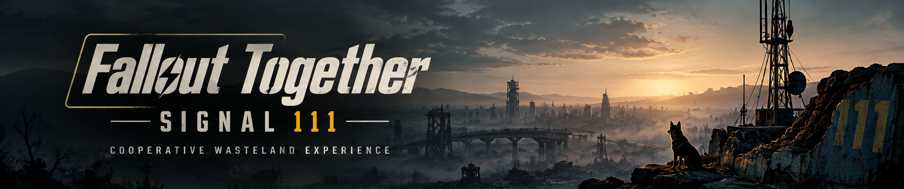

# Fallout Together: Signal 111

Fallout 4 co-op mod. In development, with two-player co-op as the first goal.

**Not playable yet. No public download available.**

 

[Discord](https://discord.gg/cmmpRTgCPa) · [Changelog](CHANGELOG.md) · [Roadmap](docs/ROADMAP.md) · [Dev log](docs/DEVELOPMENT-TRACKER-EN.md)

## Progress

*Updated October 28, 2026*

| Feature | Status |
| --- | --- |
| Fallout 4 client-to-server connection | **Verified in-game** |
| Two clients and separate network IDs | **Verified in-game, main menus** |
| Read-only player position and rotation in a loaded world | **Verified in a solo-host game test** |
| Two-PC transfer of player-position data | **97 samples verified**, but the full test failed during disconnect |
| Disconnect handling for the two-PC test | Fix passed offline checks; **not retested live** |
| Local diagnostic actor creation/removal | Built and checked offline; **not run in-game** |
| Protection of original saves | **Not yet verified** |
| Two players in the same world | **Not yet verified** |
| Remote character spawning and movement | **Not yet implemented or verified in-game** |

### What changed

- **Player data in a loaded world:** a real solo-host test captured changing player position and rotation. A later limited recording produced 97 samples.
- **Two physical PCs:** the host sent 97 pose samples through the server to the guest. The received sequence and all six position/rotation values per sample matched exactly. The overall attempt still **failed** because disconnect/timeout handling was not clean.
- **Disconnect fix:** the marker-publication problem was reproduced and a fix passed offline tests. The fixed version has **not** been tested in a new live session.
- **Next actor test:** a separate diagnostic module for creating, observing, and removing one local actor is built and offline-tested. It has **not** been installed or run in Fallout 4.

Transferring coordinates is not the same as spawning a second character or synchronizing multiplayer gameplay.

## Roadmap

- [x] Establish a real Fallout 4 client-to-server connection.
- [x] Connect two real clients and verify distinct network IDs in menus.
- [x] Capture the local player's position and rotation in a loaded solo world.
- [x] Verify transfer of 97 player-position samples between two physical PCs (data only).
- [ ] Confirm save and game-profile isolation for controlled testing.
- [ ] Verify clean two-PC disconnects with the revised diagnostic protocol.
- [ ] Create, observe, and remove one local diagnostic actor in-game.
- [ ] Admit two players into one compatible, host-controlled world.
- [ ] Spawn and synchronize the remote character and basic movement.
- [ ] Add gameplay systems, test stability, and prepare a public build.

Completed data tests do **not** mean that playable co-op is ready. See the [detailed roadmap](docs/ROADMAP.md).

## FAQ

**Can I download and play it?** Not yet.

**Can two players see each other in the same world?** Not yet. The recent two-PC result verified coordinate data transfer, not a shared world or remote player.

**Are existing saves safe for testing?** Full protection has not been verified. No public test build is available.

## Dev log

[English](docs/DEVELOPMENT-TRACKER-EN.md) · [Русский](docs/DEVELOPMENT-TRACKER-RU.md) · [Español](docs/DEVELOPMENT-TRACKER-ES.md) · [Português (Brasil)](docs/DEVELOPMENT-TRACKER-PT-BR.md) · [简体中文](docs/DEVELOPMENT-TRACKER-ZH-CN.md)

[Changelog](CHANGELOG.md) · [Releases](docs/VERSIONING.md) · [Issues](https://github.com/PawPaw228/Fallout-Together-Signal_111/issues)

## Community and support

[Discord](https://discord.gg/cmmpRTgCPa) · [Patreon](https://www.patreon.com/cw/pawpaw228) · [Ko-fi](https://ko-fi.com/pawpaw228)

Support is optional. Development updates remain public.

## Credits

Based in part on work from [TiltedEvolution](https://github.com/tiltedphoques/TiltedEvolution). Required third-party credits and licenses will accompany any future source or binary distribution.

Fallout 4 belongs to Bethesda and its respective owners. Signal 111 is an unofficial fan project, not affiliated with Bethesda.
